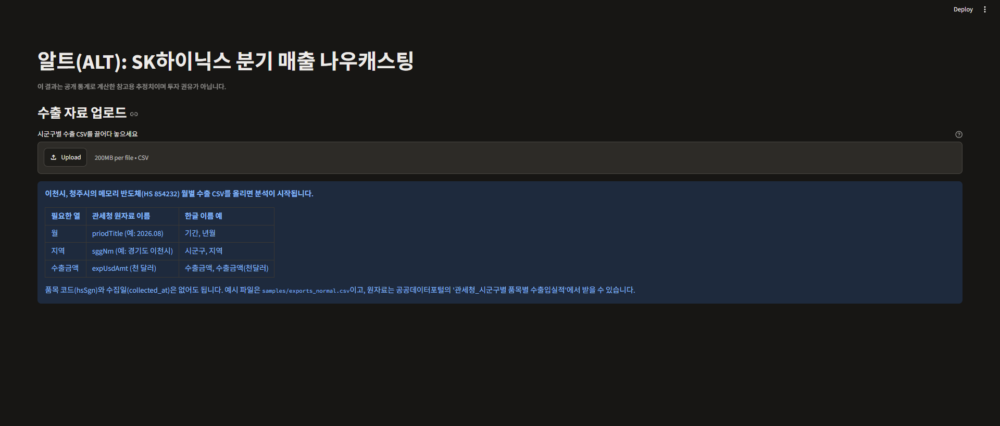
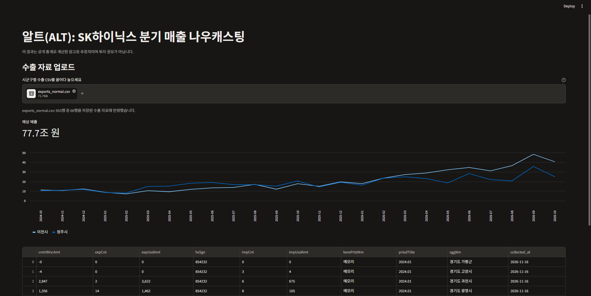
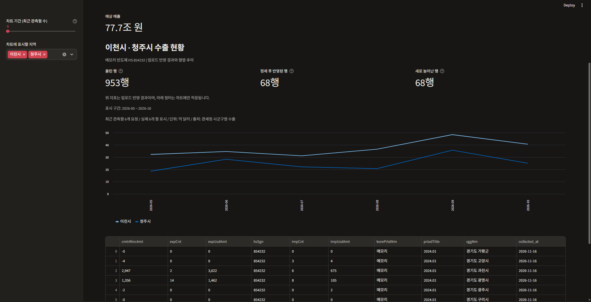
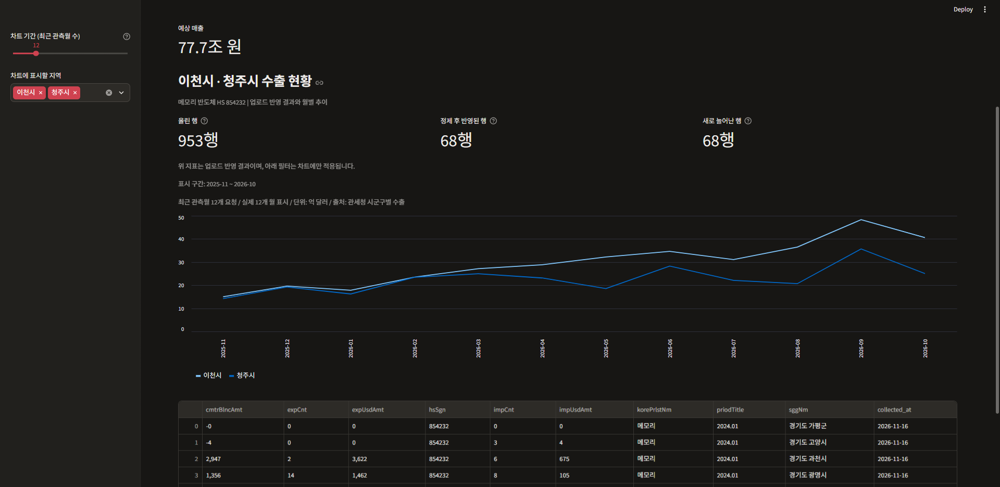
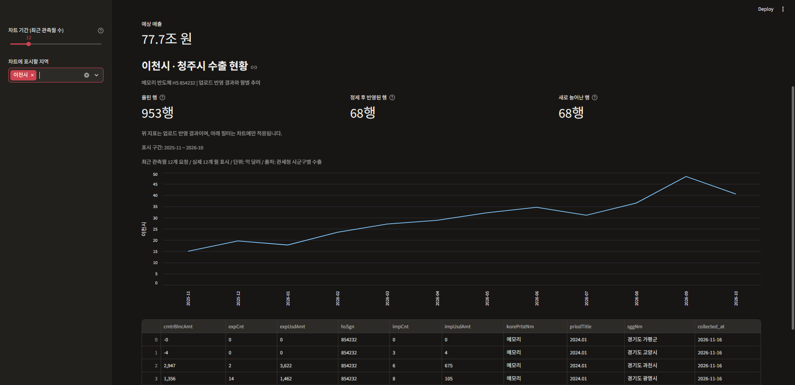
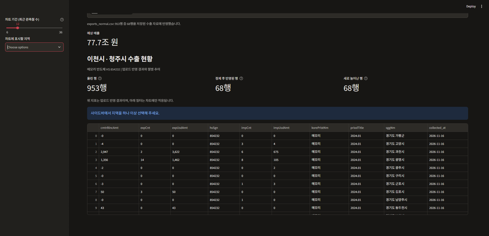
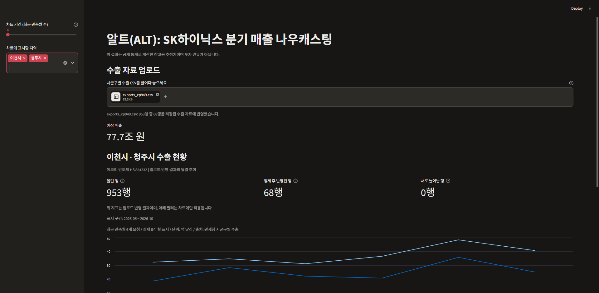
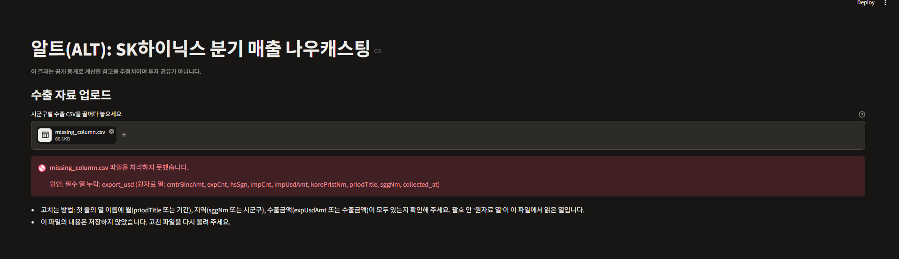

# 11주차 Streamlit 수출 현황 구현 — 신해성

## 1. 담당 범위

- 파일: `alt_backend_week11/app.py`
- 함수: `render_exports(upload)`
- 담당 기능: 업로드 반영 지표, 기간·지역 필터, 수출 차트
- 다른 담당 함수, import, 실행 순서와 백엔드 가공 로직은 변경하지 않았다.

## 2. AI 프롬프트 이력

실제 대화의 주요 요청을 요약했다.

1. 역할 배분 문서 중 신해성 담당 부분을 참고하여
   `render_exports(upload)`를 구현하도록 요청했다.
2. 데이터 가공은 팀 backend 함수로만 수행하고,
   함수 계약과 수정 범위를 지키도록 요청했다.
3. backend.py를 추가 제공한 뒤 기존 구현을 재검토하고
   정교하게 개선하도록 요청했다.
4. 과제 요구사항에 맞춰 수동 검증과 제출 절차를
   단계별로 안내하도록 요청했다.

## 3. 생성 코드와 최종 반영 내용

최종 코드는 `alt_backend_week11/app.py`의
`render_exports(upload)`에 반영했다.

- raw_rows, clean_rows, added를 지표 3개로 표시했다.
- 기간 슬라이더 값을 backend.exports_chart_table의
  last_months 인자로 전달했다.
- 백엔드 차트 표의 열 이름으로 지역 선택지를 구성했다.
- 선택 지역을 st.line_chart의 y 인자로 전달했다.
- 빈 자료와 지역 미선택 시 안내를 표시했다.
- exports_months와 exports_regions로 필터 상태를 관리했다.
- 데이터 가공과 금액 단위 변환은 backend에 위임했다.

## 4. 의심한 점과 확인·수정 내역

### 기간 필터의 의미

백엔드가 월 정렬 후 tail(N)을 사용하므로 달력상 최근 N개월이
아니라 자료가 있는 마지막 N개 관측월을 반환한다.
이에 맞춰 화면 문구를 "최근 관측월 수"로 수정했다.

### 차트 금액 단위

백엔드가 이미 달러를 억 달러로 변환한다는 점을 확인했다.
화면에서 다시 나누지 않고 반환 표를 그대로 표시했다.

### 필터 변경과 업로드 지표

필터는 차트에만 적용되어야 한다고 보고 기간·지역을 바꾸며
업로드 지표가 유지되는지 확인했다. 실제로 지표는 유지되었다.

### 지역 전체 해제

지역 선택이 없을 때 오류가 발생하거나 상세 표까지 중단되지
않아야 한다고 보고 검증했다. 안내를 표시하고 C 함수만
return하도록 구현했으며 원본 표가 유지되는 것을 확인했다.

### 잘못된 입력의 저장 영향

필수 열이 누락된 CSV가 기존 저장 자료를 변경하지 않는지
확인하기 위해 업로드 전후 exports.csv의 SHA256 해시를 비교했다.
비교 결과는 True로, 파일 내용이 유지되었다.

## 5. 수동 검증 결과

검증 환경: Windows / VS Code / Python 가상환경

### 5.1 수정 전 기본 실행

- 앱이 정상적으로 열렸다.
- 업로드 전에 CSV 안내가 표시되었다.
- 정상 CSV 업로드 후 차트와 원본 표가 표시되었다.

### 5.2 정상 CSV 및 필터

입력: exports_normal.csv

- 업로드 후 수출 지표 3개, 차트, 원본 표가 표시되었다.
- 기간·지역 필터가 표시되었다.
- 필터 변경 후 업로드 지표는 유지되었다.

| 요청 관측월 수 | 실제 표시 월 수 | 표시 구간 |
|---|---|---|
| 6 | 6 | 2026.05~2026.10 |
| 12 | 12 | 2025.11~2026.10 |
| 36 | 34 | 2024.01~2026.10 |

36개를 요청했지만 가용 자료가 34개 월이므로 34개가 표시되었다.
이천시만 선택, 청주시만 선택, 두 지역 동시 선택 모두 정상 동작했다.
지역을 모두 해제하면 안내가 표시되고 원본 표는 유지되었다.

판정: 통과.

### 5.3 cp949 CSV

입력: exports_cp949.csv

예상 결과:
인코딩 오류 없이 한글을 읽고 정상 CSV와 같은 자료를 표시한다.

실제 결과:
- 업로드 성공, 한글 표시 정상
- 올린 행: 953행
- 정제 후 반영된 행: 68행
- 새로 늘어난 행: 0행
- 같은 필터 조건에서 정상 CSV와 차트가 동일했다.

판정: 통과.

### 5.4 필수 열 누락 CSV

입력:
정상 CSV에서 expUsdAmt 열을 제거한 파일.
실제 오류 화면의 파일명은 missing_column.csv이다.
저장소에 포함한 테스트 파일은
alt_backend_week11/samples/exports_missing_column.csv이다.

예상 결과:
필수 열 누락 안내 후 분석을 중단하고 기존 저장 자료를 변경하지 않는다.

실제 오류 문구:

    필수 열 누락: export_usd (원자료 열: cmtrBlncAmt, expCnt, hsSgn, impCnt, impUsdAmt, korePrlstNm, priodTitle, sggNm, collected_at)

- 오류 안내가 표시되었다.
- 예측·차트·원본 표는 표시되지 않았다.
- Traceback은 노출되지 않았다.
- 업로드 전후 data/exports.csv의 SHA256 해시 비교 결과는 True였다.

export_usd는 백엔드의 표준 열 이름이며,
테스트에서 제거한 원자료 열은 expUsdAmt이다.

판정: 통과. 잘못된 입력을 차단하고 기존 저장 자료를 유지했다.

## 6. session_state 사용 설명

exports_months와 exports_regions에 사용자가 고른 기간과 지역을
보관하여 앱이 다시 실행되어도 선택을 유지한다.
자료 변경으로 지역 선택지가 달라지면 유효한 선택만 남긴다.
지역을 모두 해제하면 전체 선택으로 강제 복구하지 않고 안내를 표시한다.

## 7. 팀 통합 시 확인할 사항

- 최종 README에 streamlit run app.py 실행 방법과
  session_state 사용 설명을 포함해야 한다.
- 5주차 보안 체크리스트는 조장님이 통합 작성하기로 했다.
- 본 문서의 수동 검증은 로컬에서 실행한 결과이며,
  최종 main 병합 후 통합 실행을 다시 확인해야 한다.

## 8. 12주차 F4 피드백 반영 AI 이력

### 프롬프트

1. `FEEDBACK_LOG.md`의 F4 원문과 수정 전후 형식을 참고해
   차트 툴팁의 내부 필드명과 소수 다섯째 자리 문제를 반영했다.
2. `st.line_chart`를 `st.altair_chart`로 교체하고,
   월·지역·수출(억 달러) 툴팁 제목과 소수 둘째 자리 형식을 지정했다.
3. 지역 선택은 `transform_filter`로 반영하고 업로드 지표는 수정하지 않았다.
4. 차트용 긴 표는 `backend.exports_chart_long`에 추가하도록 요청했다.
5. 커밋은 긴 표 추가와 툴팁 수정으로 나누고 실제 해시를 피드백 로그에 기록했다.

### 생성 코드의 본인 수정 및 검증

- AI 제안대로 단순히 차트 한 곳만 바꾸지 않고,
  먼저 `exports_chart_long`의 월 범위와 허용 지역을 확인했다.
- 긴 표가 `ym`, `region`, `export_100m_usd` 열만 갖도록 구현했다.
- 단위 변환은 backend에만 두고 원본 `export_usd`는 유지했다.
- 툴팁 값 형식 `,.2f`와 축 형식 `,.1f`를 지정했다.
- 전체 pytest 11건을 실행해 통과했다.
- 로컬 Streamlit에서 정상 CSV를 업로드하고,
  Altair 차트가 월·지역 축과 수출 툴팁을 표시하는 것을 확인했다.

### 커밋

- `c6ee71e`: `feat: 차트용 긴 표 exports_chart_long 추가`
- `f885ca6`: `fix: 차트 툴팁의 항목 이름과 소수 자리 정리`

### pytest 결과

- `python -m pytest tests -q`
- 결과: `11 passed`
