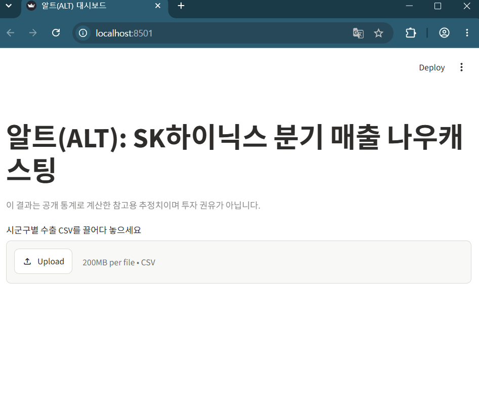
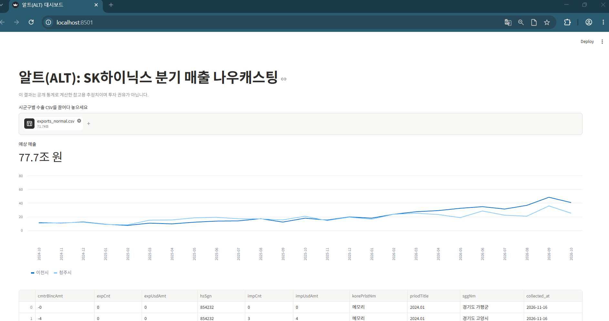
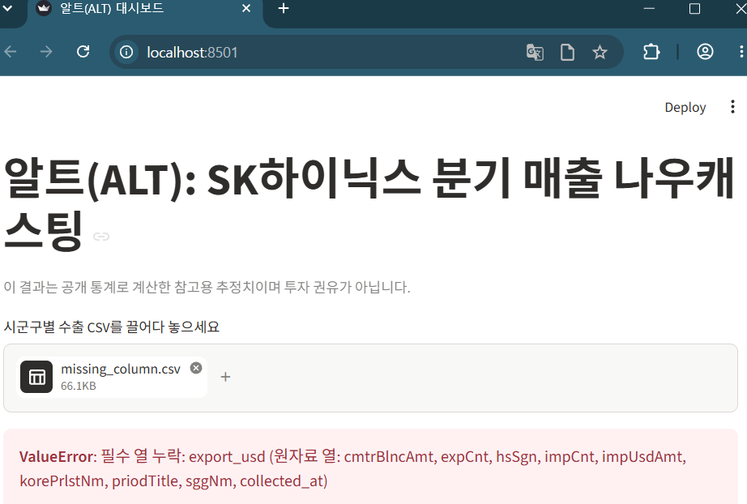
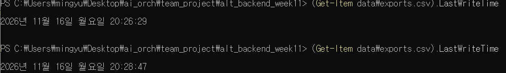

# 11주차 AI 통제 기록: app.py 화면 골격과 통합 (강민규)

## [2026-11-16] 화면 골격 app.py와 병렬 개발 규칙 (담당: 강민규)

- 대상 파일: `app.py` / 관련 커밋: `b6fc8d5`

### AI 프롬프트(요지)

- 누가 먼저 하냐에 의존하지 않고 동시에 개발할 수 있는 app.py 골격 코드를 작성해줘

### 생성 코드(요지)

- 함수 4개와 맨 아래 실행 순서 4줄로 된 골격.
  - `load_upload()`: 업로드와 입력 방어 (조현모)
  - `render_forecast(upload)`: 매출 예측 (신동훈)
  - `render_exports(upload)`: 수출 현황 (신해성)
  - `render_details(upload, result)`: 브리프와 상세 표 (이다현)
- 각 함수는 두세 줄짜리 최소 구현으로 실제 데이터를 주고받는다. docstring에 '계약'(반환 모양)과 '담당자가 할 일'을 적었다.
- 구역 사이 계약: A가 돌려주는 `{"key", "raw", "imported"}`를 B, C, D가 받고, B가 돌려주는 run_forecast 결과(실패하면 None)를 D가 받는다.
- 파일 맨 위 docstring에 팀 규칙 4개를 적었다: 자기 함수만 수정, pandas import 금지, import 줄은 합의 후 수정, 위젯 key와 session_state 키 접두어.
- app.py에는 pandas import가 없고, 가공은 모두 backend 함수 호출이다.

### 본인이 발견한 문제

- 처음 역할 분담안은 업로드, 예측, 표가 순서로 묶여 있었다. 앞 사람이 끝나야 다음 사람이 화면에서 결과를 볼 수 있어, 팀원별 커밋을 보는 과제에서 대기 시간이 생긴다.
  - 사이드바를 한 사람이 맡으면 차트 담당이 필터 값을 기다려야 한다.
  - 지역 필터를 새 백엔드 함수로 만들면 백엔드 수정을 기다려야 한다.
- 골격 상태에서 두 가지 문제가 있었다.
  - 잘못된 CSV(열 누락, 이천시와 청주시가 없는 파일)에서 처리되지 않은 ValueError가 난다.
  - 스크립트가 다시 실행될 때마다 CSV를 다시 정제하고 저장한다.

### 수정 내역

- 순서 의존을 "골격 커밋 1개"로 줄였다. 골격이 처음부터 끝까지 돌아가게 하고, 각자 자기 함수 본문만 바꾼다.
- 필터는 그 값을 쓰는 구역이 직접 `st.sidebar`로 만들게 했다(사이드바 담당 없음).
- 지역 필터는 `st.line_chart(표, y=고른 지역)`으로 고르게 해서 백엔드 수정이 필요 없게 했다.
- 골격 상태의 두 가지 문제는 일부러 골격에서 고치지 않았다. 파트 A docstring의 '할 일'로 넘겼다(입력 방어와 session_state).

### 수동 검증 결과

`streamlit run app.py`로 골격을 브라우저에서 실행해 확인했다. 

| 번호 | 시나리오 | 결과 | 캡처 |
|---|---|---|---|
| 1 | 업로드 전 | 업로드 창만 보이고 아래는 비어 있다. st.stop()으로 멈춘 상태다(안내 문구는 파트 A 할 일). | week11_skeleton_01_before.png |
| 2 | 정상 CSV | 예상 매출 77.7조 원, 이천시와 청주시 월별 선 그래프(2024-10부터 2026-10까지 25개월), 원본 표가 오류 없이 나온다. | week11_skeleton_02_normal.png |
| 3 | 컬럼 누락 CSV | 빨간 오류 화면에 `ValueError: 필수 열 누락: export_usd`가 나오고 앱이 멈춘다. 파트 A에서 수정한다. | week11_skeleton_03_missing.png |
| 4 | 다시 실행 | 같은 CSV를 올린 채 다시 실행할 때마다 data/exports.csv 수정 시각이 바뀐다. 매번 다시 정제하고 저장한다는 뜻이며, 파트 A의 session_state로 수정한다. | week11_skeleton_04_rerun.png |

### 판단 메모

- 주고받는 값의 모양(계약)을 먼저 고정하고 최소 동작 구현을 깔아 두면, 사람 사이의 순서 의존이 코드 사이의 계약 의존으로 바뀐다.
- 계약을 docstring에 두어서, 팀원이 자기 함수 docstring을 AI 프롬프트에 그대로 넣으면 계약에서 벗어나지 않게 했다.