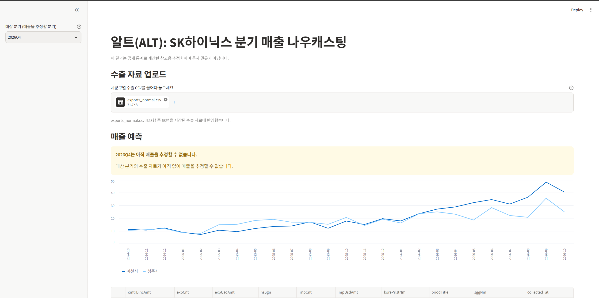
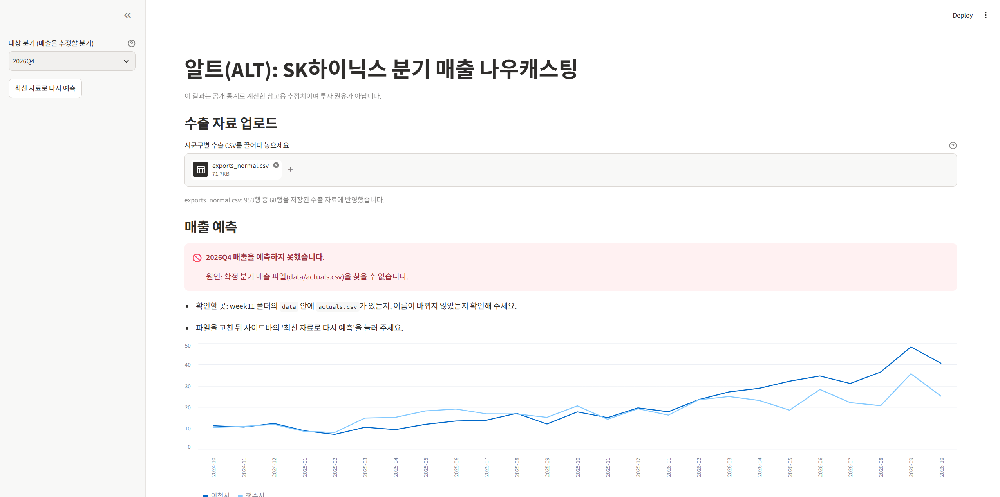
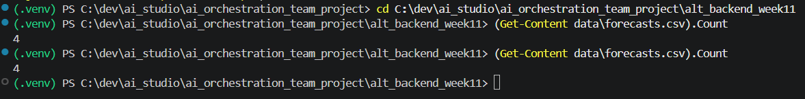
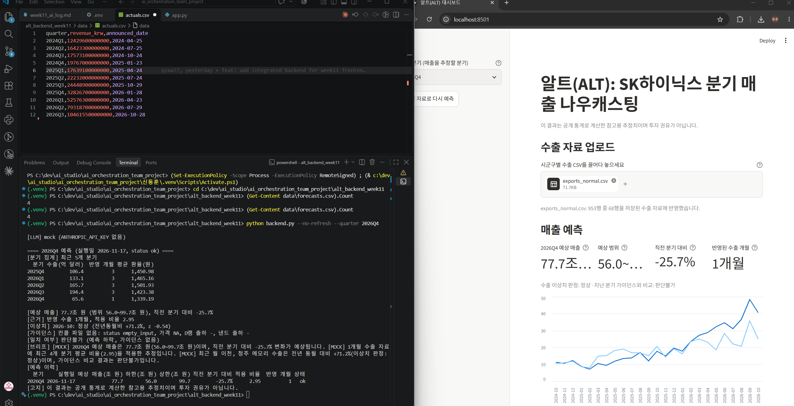
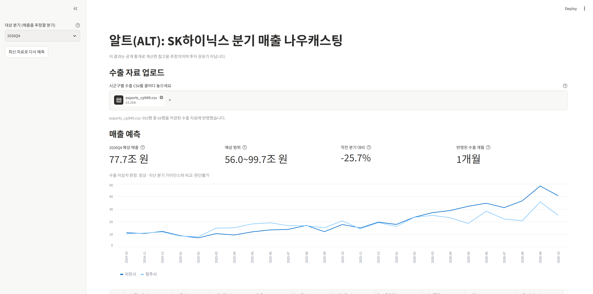
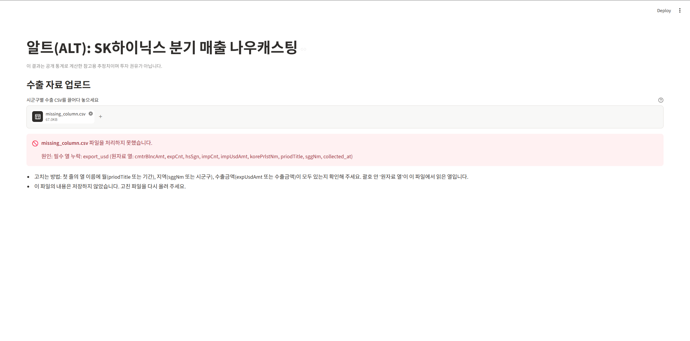

# 11주차 AI 통제 기록: B. 매출 예측 render_forecast (신동훈)

- 대상 파일: `alt_backend_week11/app.py`의 `render_forecast(upload)` (B 구역)
- 브랜치: `feat/forecast-donghoon`
- 관련 커밋: 프롬프트 기록 `<해시>` → AI 생성본 `<해시>` → 수정 `1b0aacd`, `810a4d6`, `a5470f3`, `2b78a90` → 과정 기록 `docs:` 커밋
- 과제에서 채우는 항목: 사이드바 필터(대상 분기 selectbox), `st.metric` 2개 이상

---

## 1. AI 프롬프트 이력

### [1차] 2026-11-16: render_forecast 본문 구현 요청

**프롬프트를 만든 근거**
- main의 골격 `app.py`(`b6fc8d5`): B 구역 docstring의 '계약'과 '담당자가 할 일', 파일 맨 위의 팀 규칙 4개
- 역할 배분 문서의 B 구역 항목(꼭 구현할 것, 지켜야 할 점, 확인 방법)과 '모두 꼭 지킬 것'
- `backend.py`의 `run_forecast`, `list_target_quarters`, `default_target_quarter` docstring
- `llm_module.build_brief_facts`가 돌려주는 `facts`의 키와 예시 값

**프롬프트에 일부러 넣은 것**
- **import 제한:** app.py에는 `import streamlit as st`, `import backend`만 있다. `forecaster.FORECAST_STATUS_OK` 같은 상수를 쓰려면 import를 새로 추가해야 하는데, 이는 팀 합의가 필요하다. 그래서 status는 `"ok"` 문자열로 비교하게 했다.
- **Streamlit 1.36 인자만 사용:** requirements가 `streamlit>=1.36`이다. AI는 최신 인자(`width="stretch"`, `border` 등)를 자주 쓰므로, 1.36에 있는 인자만 쓰라고 못박았다.
- **session_state 보관:** C 구역 슬라이더만 움직여도 `run_forecast`가 다시 실행된다. 그러면 `data/forecasts.csv`에 같은 행이 쌓이고, 키가 있으면 LLM도 다시 부른다. 그래서 (업로드 key, 분기)가 같으면 보관한 결과를 쓰게 했다. 오류 결과(None)는 보관하지 않게 했다.
- **잡을 예외 범위:** `run_forecast`의 docstring에 적힌 `ValueError`, `FileNotFoundError`만 잡는다. `except Exception`은 코드 실수까지 가리므로 금지했다.

**프롬프트 원문**

```text
당신은 Streamlit 대시보드 화면 개발을 돕는 어시스턴트입니다.
SK하이닉스 분기 매출 나우캐스팅 대시보드(app.py)의 'B. 매출 예측' 구역 함수 본문을 구현해 주세요.
다섯 명이 app.py 한 파일을 동시에 고치므로, 아래 범위를 벗어나는 코드는 쓰지 마세요.

[시그니처 – 변경 금지]
def render_forecast(upload: dict) -> dict | None:

[입력 명세]
upload: A 구역 load_upload()의 반환값. 이 함수에서는 upload["key"]만 쓴다.
 {"key": ("exports_normal.csv", 20480), "raw": DataFrame, "imported": dict}
 - key (tuple): (파일 이름, 파일 크기). 같은 업로드인지 알아보는 값
 - 업로드 전이거나 잘못된 파일이면 A가 st.stop()하므로, 이 함수에 None은 들어오지 않는다

[사용할 backend 함수 – 이미 있음, 수정 금지]
- backend.list_target_quarters() -> list[str]: 대상 분기 목록, 최근 분기부터 (예: ["2026Q4", "2026Q3", ...])
- backend.default_target_quarter() -> str: 기본 대상 분기 (예: "2026Q4")
- backend.run_forecast(target_quarter: str) -> dict
  - result["status"]: "ok" | "no_data" | "insufficient_history"
  - result["facts"]: 화면 표시용 문자열 dict. 값이 없으면 "확인 불가"
    {"quarter": "2026Q4", "estimate": "26.1조 원", "range": "24.4~27.8조 원", "qoq": "+16.5%",
     "months": "2개월", "ratio": "1.50", "export_yoy": "+40.0%", "anomaly": "정상", "consistency": "일치"}
  - result["brief"]: 요약 문장(str). status가 "ok"가 아니면 예측할 수 없는 이유를 설명하는 안내 문장
  - Raises: ValueError(분기 형식 오류, actuals.csv 형식 오류, 컨콜 파일 인코딩 오류), FileNotFoundError(data/actuals.csv 없음)
  - 실행할 때마다 data/forecasts.csv에 기록하고, ANTHROPIC_API_KEY가 있으면 LLM을 최대 2번 부른다

[출력 명세]
- 성공: backend.run_forecast의 결과 dict를 손대지 않고 그대로 반환 (D 구역이 brief, quarterly, history를 쓴다)
- run_forecast가 ValueError 또는 FileNotFoundError를 내면: None 반환

[화면 요구사항]
1. st.subheader로 구역 제목을 단다
2. 사이드바 st.selectbox(대상 분기): 목록은 list_target_quarters(), 기본값은 default_target_quarter().
   기본값이 목록에 없을 때도 오류가 나지 않게 한다. 분기를 바꾸면 바로 다시 예측된다
3. st.metric 2개 이상: facts의 estimate, range, qoq, months 등을 st.columns로 가로 배치
   - 값은 facts 문자열을 그대로 쓴다. 숫자로 바꾸거나 다시 계산하지 않는다
   - help 툴팁으로 계산 방법(최근 4개 분기의 매출÷수출 비율을 적용)을 짧게 설명한다
4. 이상치 판정(facts["anomaly"])과 가이던스 비교(facts["consistency"])를 한 줄로 보여 준다
5. 문구: 개인투자자 대상 존댓말, 매수/매도 같은 권유 표현 금지. 단위는 조 원

[예외·경계 방침]
- status가 "ok"가 아니면 지표 숫자 대신 result["brief"]를 st.info 또는 st.warning으로 보여 주고, result는 그대로 반환한다
- ValueError, FileNotFoundError는 st.error로 원인과 확인할 곳(data/actuals.csv 등)을 안내하고 None을 반환한다
- 그 밖의 예외는 잡지 않는다 (except Exception 금지: 코드 실수까지 가린다)
- facts 값이 "확인 불가"여도 화면이 깨지거나 어색하지 않게 한다

[session_state – 같은 분기, 같은 업로드면 다시 실행하지 않기]
- C 구역의 슬라이더만 움직여도 스크립트 전체가 다시 실행되어 run_forecast가 매번 불린다(forecasts.csv 중복 기록, LLM 재호출)
- (upload["key"], 대상 분기)가 마지막 실행과 같으면 보관한 결과를 쓰고, 다르면 새로 실행한다
- 초기화는 if "키" not in st.session_state: 관용구로 한다
- 오류가 난 결과(None)는 보관하지 않는다 (파일을 고친 뒤 다시 시도할 수 있게)

[제약 조건]
- 위 함수 본문과 docstring, 그리고 바로 아래에 둘 _로 시작하는 보조 함수만 작성한다
- import 줄은 추가하지 않는다. 사용할 수 있는 것은 import streamlit as st, import backend 뿐이다
- pandas 금지 (import도, DataFrame을 거르거나 계산하는 코드도 쓰지 않는다)
- 위젯 key와 session_state 키는 모두 forecast_ 접두어로 시작한다 (예: forecast_quarter, forecast_cache_key)
- 다른 구역의 session_state 키(upload_, exports_, details_)는 읽거나 쓰지 않는다
- Streamlit 1.36에 있는 인자만 쓴다 (그 이후 버전에 생긴 인자는 쓰지 않는다)
- 타입 힌트와 docstring 필수. docstring의 '계약' 부분(upload 인자, 반환값)은 그대로 유지한다

[통과해야 할 확인]
- 분기를 바꾸면 지표가 바로 바뀐다
- 2024Q1을 고르면 숫자 대신 "비교할 과거 실적 부족" 안내가 나오고 앱은 그대로 동작한다
- data/actuals.csv를 잠시 다른 이름으로 바꾸면 st.error 안내가 나오고 None이 반환된다 (앱은 죽지 않는다)
- 같은 파일, 같은 분기에서 다른 구역 위젯만 움직이면 data/forecasts.csv의 행 수가 늘지 않는다
- 지표 숫자가 python backend.py --no-refresh --quarter <같은 분기> 출력과 같다
```

<!-- 2차 이후 프롬프트(수정 요청)가 생기면 [2차] 제목으로 아래에 이어서 적는다 -->

---

## 2. 생성 코드

- 생성 도구: copilot (1차 프롬프트 그대로 입력)
- 생성본 커밋: `be8b205` (고치지 않고 그대로 커밋해 보존)
- 코드 요지: `render_forecast` 본문과 보조 함수 3개(`_select_forecast_quarter`, `_show_forecast_metrics`, `_show_forecast_error`)
  - **사이드바 selectbox:** 라벨 "대상 분기 (매출을 추정할 분기)", key `forecast_quarter`. 목록은 `list_target_quarters()`, 기본값은 `default_target_quarter()`. 기본값이 목록에 없으면 첫 번째 분기를 고른다.
  - **session_state:** `forecast_cache_key`(마지막 (업로드 key, 분기)), `forecast_result`(그 결과). `if "forecast_cache_key" not in st.session_state:` 관용구로 초기화하고, 키가 같으면 `run_forecast`를 다시 부르지 않는다. 오류가 나면 보관하지 않는다.
  - **지표:** `st.columns(4)`에 예상 매출, 예상 범위, 직전 분기 대비, 반영된 수출 개월을 `facts` 문자열 그대로 보여 준다. 각 지표에 계산 방법 help 툴팁. 아래 `st.caption`에 이상치 판정과 가이던스 비교 한 줄.
  - **status가 "ok"가 아닐 때:** `st.warning`에 "`<분기>`는 아직 매출을 추정할 수 없습니다." + `result["brief"]`를 보여 주고 result를 그대로 돌려준다.
  - **예외:** `except (ValueError, FileNotFoundError)`만 잡아 `st.error`로 원인을 보여 주고, 오류 종류에 따라 확인할 곳(`data/actuals.csv` 등)을 안내한 뒤 None을 돌려준다.
  - import 추가 없음, pandas 없음. 위젯과 session_state 키는 모두 `forecast_` 접두어.

<details>
<summary>생성 코드 원문 (펼치기)</summary>

```python
# =============================================================================
# B. 매출 예측 (담당: 신동훈)
# =============================================================================
def render_forecast(upload: dict) -> dict | None:
    """대상 분기를 고르게 하고 예측을 실행해 핵심 지표를 보여 준다.

    계약:
        upload: load_upload()의 반환값
        반환: backend.run_forecast의 결과 dict (D 구역이 브리프와 표에 쓴다). 예측을 실행하지 못했으면 None

    구현 메모:
        - 사이드바 selectbox로 대상 분기를 고른다. 목록은 backend.list_target_quarters(),
          기본값은 backend.default_target_quarter()이다.
        - session_state의 forecast_cache_key, forecast_result에 마지막으로 실행한 (업로드 key, 분기)와 결과를 둔다.
          다른 구역의 위젯을 움직여도 스크립트 전체가 다시 실행되는데, 그때마다 run_forecast를 다시 불러
          data/forecasts.csv에 같은 기록이 쌓이고 LLM을 다시 부르지 않기 위해서다.
        - 예측할 수 없는 분기(status가 "ok"가 아님)는 숫자 대신 result["brief"]의 안내 문장을 보여 준다.
        - run_forecast의 ValueError, FileNotFoundError는 st.error로 안내하고 None을 돌려준다.
          오류 결과는 보관하지 않아, 파일을 고친 뒤 다시 실행하면 새로 예측한다.
    """
    st.subheader("매출 예측")
    if "forecast_cache_key" not in st.session_state:  # 초기화 관용구: 세션에서 처음 한 번만 만든다
        st.session_state.forecast_cache_key = None
        st.session_state.forecast_result = None

    quarter = _select_forecast_quarter()
    cache_key = (upload["key"], quarter)
    if st.session_state.forecast_cache_key == cache_key:  # 같은 업로드, 같은 분기면 보관한 결과를 쓴다
        result = st.session_state.forecast_result
    else:
        try:
            result = backend.run_forecast(quarter)
        except (ValueError, FileNotFoundError) as exc:
            _show_forecast_error(quarter, exc)
            return None
        st.session_state.forecast_cache_key = cache_key
        st.session_state.forecast_result = result

    if result["status"] != "ok":
        st.warning(f"**{quarter}는 아직 매출을 추정할 수 없습니다.**\n\n{result['brief']}")
        return result

    _show_forecast_metrics(result["facts"])
    return result


def _select_forecast_quarter() -> str:
    """사이드바에서 대상 분기를 고르게 하고 고른 분기("YYYYQn")를 돌려준다."""
    quarters = backend.list_target_quarters()
    default = backend.default_target_quarter()
    index = quarters.index(default) if default in quarters else 0
    return st.sidebar.selectbox(
        "대상 분기 (매출을 추정할 분기)",
        quarters,
        index=index,
        key="forecast_quarter",
        help="수출 자료가 있는 분기와 진행 중인 분기를 고를 수 있습니다. "
        "기본값은 이천시와 청주시 수출이 모두 집계된 가장 최근 달의 분기입니다.",
    )


def _show_forecast_metrics(facts: dict) -> None:
    """facts의 표시용 문자열로 핵심 지표 4개와 판정 한 줄을 보여 준다."""
    col1, col2, col3, col4 = st.columns(4)
    col1.metric(
        f"{facts['quarter']} 예상 매출",
        facts["estimate"],
        help="최근 4개 분기의 '매출 ÷ 원화 환산 수출' 비율 평균을 이번 분기 수출에 곱해 추정했습니다.",
    )
    col2.metric("예상 범위", facts["range"], help="최근 4개 분기 비율의 최솟값과 최댓값을 적용한 범위입니다.")
    col3.metric("직전 분기 대비", facts["qoq"], help="직전 분기 확정 매출과 비교한 예상 매출의 변화율입니다.")
    col4.metric(
        "반영된 수출 개월",
        facts["months"],
        help="이번 분기 3개월 중 수출 자료가 공표된 개월 수입니다. 3개월 미만이면 3개월로 환산했습니다.",
    )
    st.caption(f"수출 이상치 판정: {facts['anomaly']} · 지난 분기 가이던스와 비교: {facts['consistency']}")


def _show_forecast_error(quarter: str, exc: Exception) -> None:
    """run_forecast가 낸 오류의 원인과 확인할 곳을 보여 준다."""
    st.error(f"**{quarter} 매출을 예측하지 못했습니다.**\n\n원인: {exc}", icon="🚫")
    if isinstance(exc, FileNotFoundError):
        st.markdown("- 확인할 곳: `data/actuals.csv`(확정 분기 매출) 파일이 week11 폴더의 data 안에 있는지 확인해 주세요.")
    else:
        st.markdown("- 확인할 곳: `data/actuals.csv`의 형식이나 `data/transcripts/`의 컨콜 파일 인코딩을 확인해 주세요.")
```

</details>

---

## 3. 본인이 발견한 문제

`streamlit run app.py`로 생성본을 브라우저에서 실행하고 `samples/exports_normal.csv`를 올린 뒤, 프롬프트의 '통과해야 할 확인'을 하나씩 해 보며 찾았다.

| 번호 | 문제 | 어떻게 발견했는지 | 위치 |
|---|---|---|---|
| 1 | **보관한 결과가 파일 변경을 모른다.** 같은 분기를 보는 중에 `data/actuals.csv` 이름을 바꿔도 오류 안내가 나오지 않고 예전 결과가 그대로 보였다. 분기를 바꿔야 오류가 나왔다. 오류가 난 뒤에도 보관한 결과는 남아 있어, 다른 위젯을 움직이면 예전 결과가 다시 나타날 수 있었다. | 확인 3번(actuals.csv 이름 바꾸기). 프롬프트의 session_state 요구가 이 확인과 서로 부딪힌다는 것을 알게 됐다. | `render_forecast`의 캐시 비교, `except` 블록 |
| 2 | **오류 원문이 그대로 노출된다.** 원인 칸에 `[Errno 2] No such file or directory: 'C:\dev\...\data\actuals.csv'`처럼 영어 원문과 내 PC의 전체 경로가 나왔다. 개인투자자에게 의미가 없고, 로컬 폴더 구조가 화면에 드러난다. | 확인 3번에서 분기를 바꿨을 때 | `_show_forecast_error` |
| 3 | **조사가 어색하다.** "2024Q1는 아직 매출을 추정할 수 없습니다." '2024Q1'은 '…일'로 읽으므로 '은'이 맞다. 분기 이름에 조사를 직접 붙이면 분기마다 받침이 달라진다. | 확인 2번(2024Q1 선택) | `render_forecast`의 `st.warning` |
| 4 | **안내 문장이 실제 원인과 다르다.** fx.csv가 없는 상태에서 수출 CSV를 올렸는데도 "대상 분기의 수출 자료가 아직 없어 매출을 추정할 수 없습니다"가 나왔다. 실제 원인은 환율 자료가 없는 것이다. backend는 수출이나 환율 중 하나라도 없으면 같은 no_data 문장을 돌려준다. | fx.csv를 받기 전 처음 실행했을 때 | `render_forecast`의 status 분기 |

생성본에서 문제가 없다고 확인한 것:
- import 추가 없음, pandas 없음, 위젯과 session_state 키 모두 `forecast_` 접두어, 초기화 관용구 있음
- help 툴팁의 계산 설명(비율 평균, 최솟값과 최댓값 범위, 3개월 환산)이 `forecaster.estimate_revenue` 코드와 같은지 대조했다. 10주차에 내가 만든 함수라 직접 확인할 수 있었다.
- `st.metric`의 `help`, `st.sidebar.selectbox`, `st.error`의 `icon`은 Streamlit 1.36에 있는 인자다.

---

## 4. 수정 내역

문제 하나당 `fix:` 커밋 하나로 나눴다. 시그니처와 반환값(계약)은 바꾸지 않았다.

| 문제 번호 | 수정 내용 | 커밋 |
|---|---|---|
| 1 | 사이드바에 '최신 자료로 다시 예측' 버튼(key `forecast_refresh`)을 추가해, 누르면 보관한 결과를 쓰지 않고 다시 실행한다. 오류가 나면 `forecast_cache_key`, `forecast_result`를 비워 예전 결과가 다시 보이지 않게 했다. 파일 수정 시각으로 자동 감지하려면 `os` import가 필요해 팀 규칙(import 추가는 합의 후)에 걸려 버튼 방식을 택했다. | `1b0aacd` |
| 2 | `FileNotFoundError`는 원문 대신 "확정 분기 매출 파일(data/actuals.csv)을 찾을 수 없습니다"로 보여 준다. backend의 `ValueError` 문장은 "필수 열 누락: …"처럼 한국어 한 줄이라 그대로 둔다. 고친 뒤 다시 예측 버튼을 누르라는 안내를 더했다. | `810a4d6` |
| 3 | "`<분기>` 매출은 아직 추정할 수 없습니다."로 바꿔, 조사가 분기 이름이 아니라 '매출'에 붙게 했다. | `a5470f3` |
| 4 | status가 no_data일 때 "수출 CSV를 올렸는데도 이 안내가 나오면 환율 자료(data/fx.csv)가 있는지 확인해 주세요"를 `st.caption`으로 덧붙였다. backend 문장 자체를 고치는 것은 조현모 님 담당이라, 화면에서 확인할 곳만 안내했다. | `2b78a90` |

---

## 5. 수동 검증 시나리오 결과

`alt_backend_week11` 폴더에서 `streamlit run app.py`를 실행하고, fix 4개를 모두 반영한 코드로 확인했다.

- 실행 환경: Windows, Streamlit `1.67.0`, Python `3.13.14`
- 공통 조건: `data/fx.csv` 있음(ECOS API 키로 `python backend.py`를 실행해 직접 받음), ANTHROPIC_API_KEY 없음(브리프는 `[MOCK]`), 업로드 파일 `samples/exports_normal.csv`

### 5-1. B 구역 확인 시나리오 (프롬프트의 '통과해야 할 확인')

| 번호 | 시나리오 | 기대 결과 | 실제 결과 | 캡처 |
|---|---|---|---|---|
| 1 | 사이드바에서 분기 바꾸기 (`2026Q4` → `2026Q3`) | 지표가 바로 바뀜 | 분기를 바꾸자 지표 4개가 바로 바뀌었다. `2026Q4` 예상 매출 `○○조 원` → `2026Q3` `○○조 원` | `b1_quarter_change.png` |
| 2 | 2024Q1 선택 | 숫자 대신 "비교할 과거 실적 부족" 안내, 앱은 그대로 | 노란 상자에 "2024Q1 매출은 아직 추정할 수 없습니다." + "비교할 과거 실적이 4개 분기보다 적어 매출을 추정할 수 없습니다."가 나오고 지표는 그려지지 않았다. fx.csv 확인 안내(no_data 전용)는 나오지 않았다. | `b2_2024q1.png` |
| 3 | `data/actuals.csv`를 `actuals.bak`으로 바꾸고 '최신 자료로 다시 예측' 클릭 | `st.error` 안내, 다른 구역은 그대로 | 빨간 상자에 "확정 분기 매출 파일(data/actuals.csv)을 찾을 수 없습니다"가 나오고 PC 경로는 보이지 않았다. 아래 수출 차트와 원본 표는 그대로 그려졌다. 이름을 되돌리고 버튼을 다시 누르자 숫자가 돌아왔다. | `b3_no_actuals.png` |
| 4 | 같은 파일, 같은 분기에서 다시 실행(R 키) | `data/forecasts.csv` 행 수가 늘지 않음 | 다시 실행 전 `4`행 → 후 `4`행으로 같았다. 내 브랜치에는 C 구역 슬라이더가 아직 없어, 위젯 조작과 똑같이 스크립트 전체를 다시 실행하는 R 키(Rerun)로 대신했다. | `b4_rerun_rows.png` |
| 5 | `python backend.py --no-refresh --quarter <분기>`와 비교 | 지표 숫자가 같음 | CLI 출력의 예상 매출 `77.7조 원`, 범위 `56~99.7조 원`, 직전 분기 대비 `-25.7%`가 화면 지표와 같았다. | `b5_cli_compare.png` |







### 5-2. 과제 공통 시나리오에서 B 구역 동작

팀 제출용 수동 검증 3종은 모든 PR이 머지된 뒤 강민규 님이 기록한다. 아래는 내 브랜치(main의 A 구역 포함)에서 B 구역이 어떻게 동작하는지 확인한 것이다.

| # | 시나리오 | 입력 파일 | 기대 결과 | 실제 결과 | 캡처 |
|---|---|---|---|---|---|
| ① | 정상 CSV | `samples/exports_normal.csv` | B 구역 지표 4개 표시 | `<분기>` 예상 매출 `○○조 원`, 범위 `○○~○○조 원`, 직전 분기 대비 `○○%`, 반영 `○개월` | `s1_normal.png` |
| ② | cp949 CSV | `samples/exports_cp949.csv` | 오류 없이 ①과 같은 결과 | ①과 같은 숫자가 나왔다. 파일이 바뀌어 업로드 key(이름, 크기)가 달라지므로 예측을 한 번 새로 실행했다. | `s2_cp949.png` |
| ③ | 열 누락 CSV | `samples/missing_column.csv` | 앱이 죽지 않고 안내 | A 구역이 "필수 열 누락" 안내 후 `st.stop()`으로 멈춰, B 구역(사이드바 분기 선택 포함)은 그려지지 않았다. Traceback은 없었다. | `s3_missing_column.png` |





- ②에서 숫자가 ①과 같다는 것은 cp949로 읽은 자료가 UTF-8과 똑같이 정제되어 예측까지 이어졌다는 뜻이다.
- ③에서 B 구역이 아예 나오지 않는 것은 A 구역 계약("처리할 수 없으면 None 대신 `st.stop()`")대로다. 그래서 B는 upload가 None인 경우를 따로 처리하지 않는다.

---

## 6. 판단 메모

- **디자인 의도:** 지표 4개(예상 매출, 예상 범위, 직전 분기 대비, 반영된 수출 개월)를 한 줄에 두어, "얼마이고, 어느 범위이고, 지난 분기보다 얼마나 달라지고, 몇 개월 자료로 계산했는지"를 한눈에 읽게 했다. 계산 방법은 화면을 복잡하게 하지 않도록 help 툴팁으로 옮겼다.
- **session_state를 쓴 이유 (README 담당에게 전달):** Streamlit은 위젯을 조작할 때마다 스크립트 전체를 다시 실행하므로, 그대로 두면 다른 구역의 필터만 움직여도 `run_forecast`가 다시 불려 `data/forecasts.csv`에 같은 기록이 쌓이고 LLM도 다시 호출된다. 그래서 마지막으로 실행한 (업로드 key, 분기)와 결과를 `forecast_cache_key`, `forecast_result`에 보관하고, 둘이 같으면 보관한 결과를 쓴다.
- **캐시와 최신성의 충돌:** 프롬프트에 "다시 실행하지 않기"와 "파일을 바꾸면 안내가 나와야 한다"를 함께 넣었는데, 둘이 부딪힌다는 것을 생성 코드를 실행하고서야 알았다(문제 1). 다음에는 캐시를 요구할 때 "무엇이 바뀌면 캐시를 버려야 하는지"까지 프롬프트에 적는다.
- **버튼 방식을 고른 이유:** 파일 수정 시각으로 자동 감지하면 더 편하지만 `os` import가 필요하고, 팀 규칙상 import 추가는 합의가 먼저다. 이번 주는 규칙 안에서 버튼으로 해결하고, 자동 감지는 12주차 UX 개선 때 제안한다.
- **백엔드 문제는 화면에서 안내만 했다:** 문제 4의 no_data 문장은 backend가 수출과 환율 부족을 구분하지 않아서 생긴다. backend는 이번 주 조현모 님만 고치기로 해서, 화면에는 확인할 곳만 덧붙이고 "no_data 원인을 수출, 환율로 나눠 달라"는 요청을 팀 채팅에 남긴다.
- **남은 한계:**
  - 보관하는 결과가 하나뿐이라, A 분기 → B 분기 → A 분기로 돌아오면 다시 실행되어 `forecasts.csv`에 행이 하나 더 생긴다.
  - '최신 자료로 다시 예측'을 누를 때마다 기록이 한 줄씩 늘어난다(의도한 동작).
  - 이런 부분은 12주차 UX 최적화 때 다시 본다.
