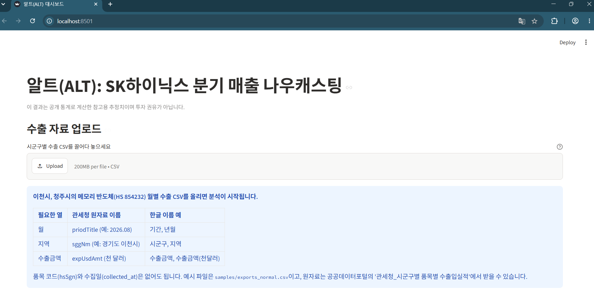
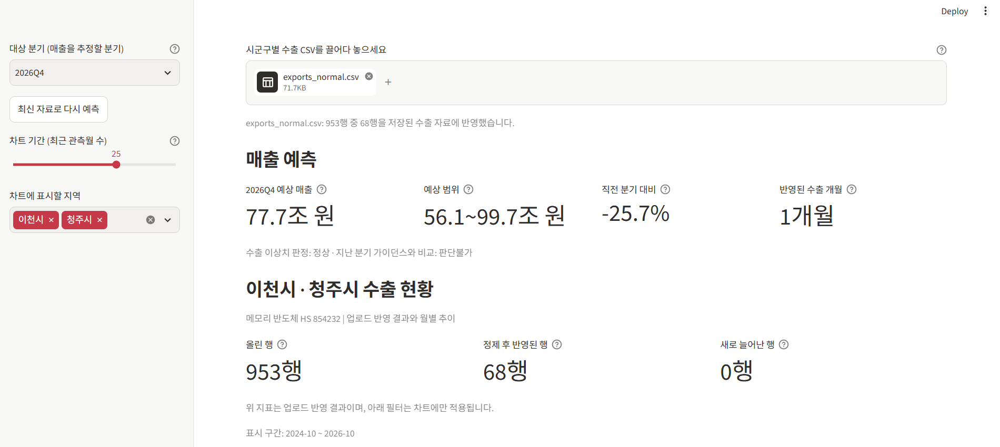
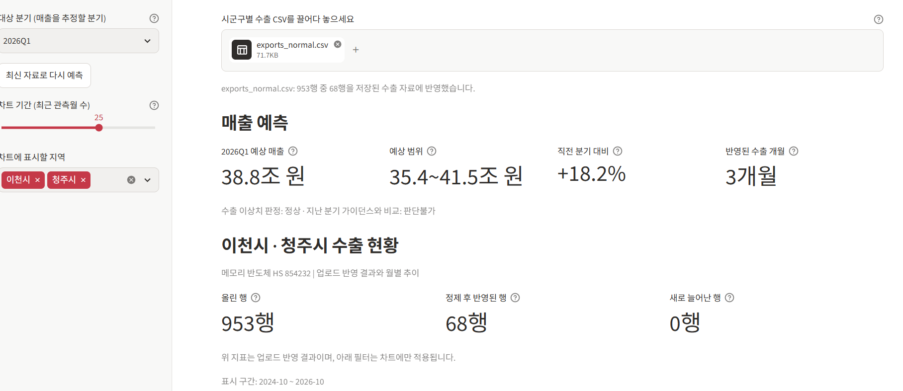
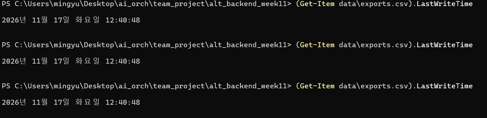
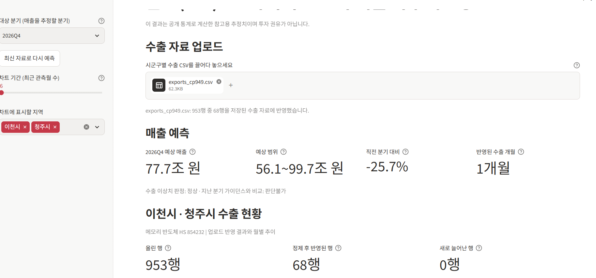
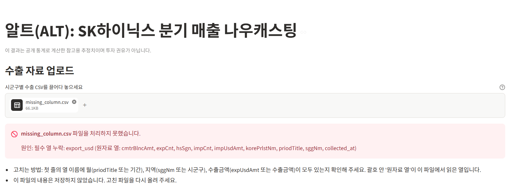

# app.py 전체 수동 검증 기록 (① 정상 CSV ② cp949 CSV ③ 컬럼 누락 CSV)

- 검증일: 2026-11-17
- 대상: 팀원 PR이 모두 머지된 최종 app.py
- 실행: `alt_backend_week11` 폴더에서 `streamlit run app.py`
- 환경: `data/fx.csv`, `data/actuals.csv` 있음, ANTHROPIC_API_KEY 없음(브리프는 [MOCK] 문장)
- 캡처: `manual_test_captures/` 폴더
- 골격 단계(수정 전) 결과는 `mingyu_app_py.md`의 수동 검증 결과에 있다.

## 테스트 파일

| 시나리오 | 파일 | 내용 |
|---|---|---|
| ① 정상 CSV | `samples/exports_normal.csv` | `python backend.py`로 받은 관세청 원자료 그대로 (UTF-8) |
| ② cp949 CSV | `samples/exports_cp949.csv` | ①을 cp949 인코딩으로 다시 저장 (엑셀 기본 CSV와 같은 인코딩) |
| ③ 컬럼 누락 CSV | `samples/missing_column.csv` | ①에서 수출금액 열 `expUsdAmt`를 삭제 |

## ① 정상 CSV

- [o] 업로드 전: '수출 자료 업로드' 제목 아래에 업로드 창과 안내 상자(필요한 열 표, 예시 파일 위치)가 보이고, 그 아래 매출 예측과 차트는 그려지지 않는다(`st.stop()`).
- [o] 업로드 후: 오류 없이 다음이 모두 나온다.
  - 반영 결과 한 줄: "exports_normal.csv: (올린 행)행 중 (반영한 행)행을 저장된 수출 자료에 반영했습니다."
  - 매출 예측 지표 4개(예상 매출, 예상 범위, 직전 분기 대비, 반영된 수출 개월)와 이상치, 가이던스 판정 한 줄
  - 수출 현황 지표 3개(올린 행, 정제 후 반영된 행, 새로 늘어난 행)와 이천시, 청주시 월별 선 그래프
  - 요약 브리프([MOCK] 문장과 그 뜻을 알려 주는 안내)와 탭 4개(정제된 수출 자료, 분기 집계, 예측 이력, 올린 원본 CSV)
  - '올린 원본 CSV' 탭의 `st.dataframe`에 올린 파일이 가공 없이 보이고, 열 이름에 한글 표시 이름이 붙는다.
- [o] 사이드바 필터가 바로 반영된다.
  - 대상 분기를 바꾸면 예상 매출 지표의 분기와 값이 바뀐다.
  - 차트 기간을 바꾸면 '표시 구간'과 그래프의 개월 수가 바뀐다.
  - 지역을 고르면 그 지역의 선만 그려진다. 지역을 모두 빼면 차트 자리에 "사이드바에서 지역을 하나 이상 선택해 주세요."가 나온다.
- [o] 다시 정제하지 않는다.
  - 같은 파일을 올린 채 차트 기간과 지역만 바꿔도 `data/exports.csv`의 수정 시각이 바뀌지 않는다(`upload_key`, `upload_result`).
  - 같은 분기면 예측도 다시 실행하지 않는다(`forecast_cache_key`, `forecast_result`).
  - 골격 단계에서는 다시 실행할 때마다 `data/exports.csv`의 수정 시각이 바뀌었다.
  - 확인 명령: PowerShell `(Get-Item data\exports.csv).LastWriteTime`, macOS `stat -f %Sm data/exports.csv`

## ② cp949 CSV

- [o] 인코딩 오류 없이 ①과 같은 지표, 차트, 원본 표가 나온다. `backend.read_uploaded_csv`가 UTF-8로 읽다 실패하면 `seek(0)`으로 처음으로 되돌린 뒤 cp949로 다시 읽기 때문이다.
- [o] 반영 결과 한 줄의 파일 이름이 exports_cp949.csv로 바뀌고, 원본 표의 한글(시군구, 품목명)이 깨지지 않는다.
- [o] 올린 행과 정제 후 반영된 행은 ①과 같고, 같은 자료가 이미 저장돼 있어 새로 늘어난 행은 0행이다.

## ③ 컬럼 누락 CSV

- [o] 빨간 오류 화면(Traceback) 대신 "missing_column.csv 파일을 처리하지 못했습니다." 오류 상자가 나온다. 골격 단계에서는 처리되지 않은 ValueError로 빨간 오류 화면이 떴다.
- [o] 오류 상자에 원인과 고치는 방법이 나온다.
  - 원인: "필수 열 누락: export_usd (원자료 열: ...)". 괄호 안에 이 파일에서 읽은 열 목록이 나와 수출금액 열이 빠진 것을 알 수 있다.
  - 고치는 방법: 월, 지역, 수출금액 열이 모두 있는지 확인하라는 안내와 "이 파일의 내용은 저장하지 않았습니다." 문구
- [o] 앱이 멈추지 않는다. 아래 매출 예측과 차트는 그려지지 않고(`st.stop()`), 정상 CSV를 다시 올리면 원래 화면으로 돌아온다.

