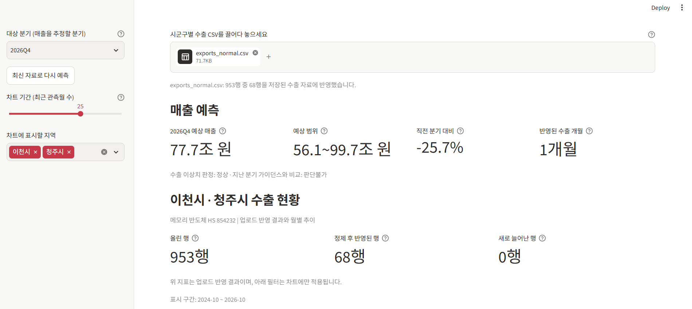
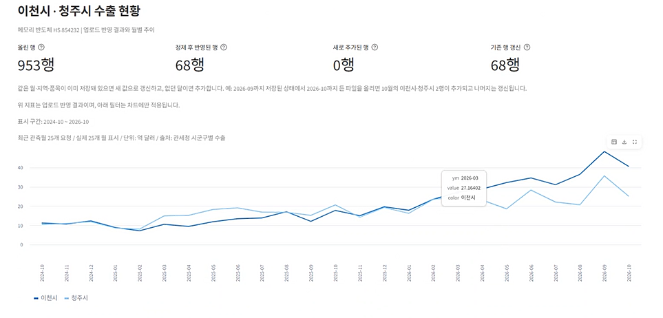
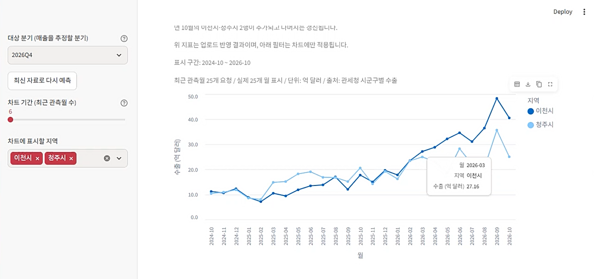
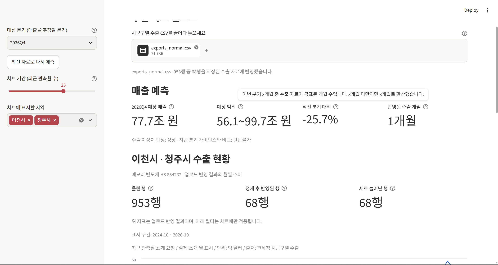
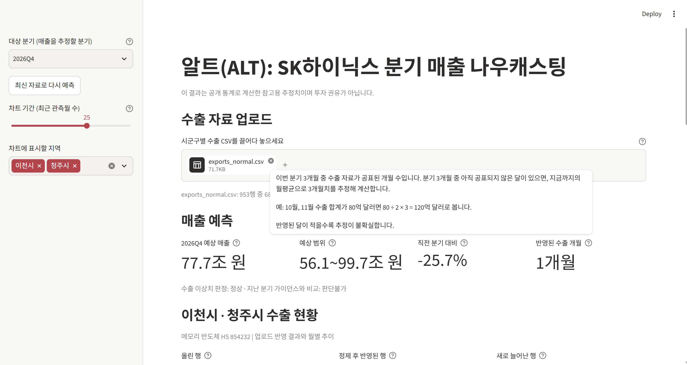

# 타 팀 피드백 반영 리포트 (FEEDBACK_LOG)

- 대상: 알트(ALT) 11주차 Streamlit 대시보드 (`app.py`, `backend.py`)
- 받은 피드백: 8건 <!-- 피드백을 준 팀과 받은 날짜를 적는다 -->
- 결정: 반영 4건(F3, F4, F6, F8) / 백로그 2건(F5, F7) / 보류 2건(F1, F2)
- 진행 현황: F3·F8과 F6 코드 반영 완료. F4는 담당자 작업 대상.
  - F3과 F8은 같은 화면(업로드 결과 지표)에 대한 피드백이라 한 번의 수정으로 함께 반영했다.

## 1. 피드백 목록과 담당 영역

반영하는 피드백은 한 건을 한 명이 원인 확인부터 수정, 캡처, 커밋까지 맡는다.
- 맡는 사람은 피드백의 원인이 있는 곳, 또는 피드백이 가리키는 화면의 담당자로 정했다. F3, F8은 원인이 백엔드의 업로드 반영 규칙(`import_exports`)이라 조현모가, F4는 차트 화면이 C 구역이라 신해성이 맡는다.

| 번호 | 피드백 요지 | 유형 | 결정 | 반영 담당 |
|---|---|---|---|---|
| F1 | 필수 열 3개만 남긴 CSV가 인코딩 오류로 분류됨 | 버그 신고 | 보류 (정상 동작) | |
| F2 | 차트 기간을 바꾼 뒤 새 CSV를 올리면 12개월로 돌아감 | 버그 신고 | 보류 (재현 안 됨) | |
| F3 | 이미 저장된 자료 때문에 '새로 늘어난 행'이 0행으로 표시됨 | 사용성 | 반영 | 조현모 |
| F4 | 차트 툴팁에 내부 필드명(ym, value)과 소수 5자리가 보임 | 사용성 | 반영 | 신해성 |
| F5 | 매출 추정이 불가능한 분기는 선택할 수 없게 | 사용성 | 백로그 | |
| F6 | '3개월 미만이면 3개월로 환산' 설명이 모호함 | 설명 문구 | 반영 | 신동훈 |
| F7 | 추정에 필요한 자료를 안내해 주는 기능 | 기능 요청 | 백로그 | |
| F8 | 어떤 경우에 새로운 행이 추가되는지 설명 필요 | 설명 요청 | 반영 (F3과 함께) | 조현모 |


## 2. 반영한 피드백

### F3, F8. 업로드 결과의 '새로 늘어난 행' 0행과 행 추가 기준

**① 받은 피드백 원문**

> (F3) exports_normal.csv를 올렸을때 이미 저장된 데이터 때문인지 새로 늘어난 행이 0행으로 표시되어 수정이 필요할 것 같습니다.

> (F8) 어떤 경우에 새로운 행이 추가되는 것인지 궁금했음. 구체적인 사례나 설명이 있으면 좋겠음.

**② 수정 전 화면과 동작**


<!-- 11주차 수동 검증 캡처 alt_backend_week11/manual_test_captures/01_normal_result.png를 복사. 같은 CSV 재업로드 후 '새로 늘어난 행 0행'이 보인다. -->

- `data/exports.csv`에 이미 들어 있는 달만 담긴 파일을 올리면 '새로 늘어난 행'이 0행으로 표시된다. 샘플 파일을 두 번째 올릴 때가 그렇다.
- 원인: `import_exports`는 월, 지역, 품목이 같은 행을 새 값으로 바꾸고(갱신) 없던 행만 추가한다. 지표는 저장 표의 행 수가 늘어난 만큼(`added`)만 보여 주므로, 모든 행이 갱신돼도 0으로 보인다. 계약대로의 동작이지만 화면에서는 "반영되지 않았다"로 읽힌다.
- 행이 언제 추가되는지에 대한 설명은 지표의 help 툴팁에만 있어, 마우스를 올리지 않으면 보이지 않았다. <!-- 현재 코드의 설명 위치를 확인해 맞춘다 -->

**③ 수정 내용과 근거**

반영 담당: 조현모

| 파일, 함수 | 수정 | 리뷰 |
|---|---|---|
| `backend.py` `import_exports` | 반환 dict에 `updated`(이번 파일의 행 중 이미 저장돼 있어 새 값으로 바꾼 행 수)를 추가. 기존 키(`raw_rows`, `clean_rows`, `added`)는 그대로 | |
| `app.py` `render_exports`의 업로드 결과 지표 부분 | 지표를 '새로 추가된 행'과 '기존 행 갱신'으로 나누고, 지표 아래에 판정 기준을 예시와 함께 한 줄로 보여 줌. 차트 부분은 고치지 않음 | 신해성 (C 담당, 확인 예정) |

화면 안내 문구: "같은 월, 지역 자료가 이미 저장돼 있으면 새 값으로 갱신하고, 없던 달이면 추가합니다. 예: 2026-09까지 저장된 상태에서 2026-10까지 든 파일을 올리면 10월의 이천시, 청주시 2행이 추가되고 나머지는 갱신됩니다."

근거
- 0행이 오류가 아니라 "모두 갱신됨"이라는 것을 숫자로 바로 보여 줘야 F3의 오해가 풀린다. 문구만 고치면 이번 파일이 반영됐는지는 여전히 알 수 없다.
- F8이 묻는 판정 기준은 툴팁이 아니라 화면에 보이는 문구로 둔다. 테스터도 툴팁을 찾지 못했다.
- 갱신 행 수는 backend가 계산하고 `app.py`는 받은 숫자를 그리기만 한다(UI와 백엔드 분리 규칙).
- `upload["imported"]`에 키가 하나 느는 계약 변경은 이 로그와 PR로 공유한다. 기존 키는 그대로라 B, D와 C의 차트 부분은 영향이 없다.
- 회귀 테스트: 같은 샘플을 두 번 올리면 첫 업로드는 추가 68행·갱신 0행, 두 번째는 추가 0행·갱신 68행이다. 기존 키 1행과 새 달 1행을 섞은 파일은 추가 1행·갱신 1행이며, 기존 금액이 새 금액으로 교체된다. 빈 표는 추가·갱신 모두 0행이다. `alt_backend_week11/tests`에서 `10 passed`.
- 실제 Streamlit 화면에서도 같은 샘플을 다시 올려 '새로 추가된 행 0행, 기존 행 갱신 68행'과 안내 문구를 확인했다. 화면 확인에는 별도 임시 데이터 폴더를 사용했다.

**④ 수정 후 화면**


- 이미 저장된 예시 CSV를 새 Streamlit 세션에서 다시 올려 '새로 추가된 행 0행, 기존 행 갱신 68행'과 추가·갱신 기준 안내 문구가 보이는 화면을 캡처했다. 실제 자료와 분리된 임시 데이터 폴더를 사용했다.

**⑤ 커밋**

| 커밋 해시 | 커밋 메시지 | 작성자 |
|---|---|---|
| `70dd052` | feat: count existing export rows updated on upload | 조현모 |
| `8575a29` | fix: show added and updated upload rows separately | 조현모 |

### F4. 차트 툴팁의 내부 필드명과 소수 자리

**① 받은 피드백 원문**

> 차트에 마우스를 올리게 되면 내부 필드명(ym,value) 등의 값이 노출되고 소숫점이 5자리까지 표시되어 가독성이 떨어져 이를 2자리로 개선하는등의 조치가 있으면 좋을 것 같습니다.

**② 수정 전 화면과 동작**


<!-- 캡처: 차트의 한 점에 마우스를 올려 툴팁이 보이는 화면 -->

- 툴팁 항목 이름이 `ym`, `value`, `color`로 나오고, 값은 `31.17140`처럼 소수 다섯째 자리까지 나온다.
- 원인: `st.line_chart`는 지역별 열을 내부에서 긴 표로 바꿔 그리며, 툴팁 제목을 표의 index 이름(`ym`)과 고정된 이름(`value`, `color`)으로 정한다. 숫자 형식을 정하는 인자도 없다. `x_label`, `y_label`은 축 이름만 바꾸고 툴팁에는 적용되지 않는다.

**③ 수정 내용과 근거**

반영 담당: 신해성

| 파일, 함수 | 수정 | 리뷰 |
|---|---|---|
| `backend.py` | 차트용 긴 표를 돌려주는 `exports_chart_long(exports, last_months)`를 `exports_chart_table` 바로 아래에 추가. 열은 `ym`, `region`, `export_100m_usd`(억 달러, 반올림하지 않음) | 조현모 |
| `app.py` `render_exports`의 차트 부분 | `st.line_chart`를 `st.altair_chart`로 바꾸고, 툴팁 제목을 월, 지역, 수출(억 달러)로, 값 형식을 소수 둘째 자리로 지정. 지역 선택은 `transform_filter`로 반영. 업로드 결과 지표 부분은 고치지 않음 | |
| `app.py` 맨 위 import 줄 | `import altair as alt` 추가 | 강민규 |

```python
chart = (
    alt.Chart(backend.exports_chart_long(imported["exports"], last_months=months))
    .transform_filter(alt.FieldOneOfPredicate(field="region", oneOf=regions))
    .mark_line(point=True)
    .encode(
        x=alt.X("ym:O", title="월"),
        y=alt.Y("export_100m_usd:Q", title="수출 (억 달러)", axis=alt.Axis(format=",.1f")),
        color=alt.Color("region:N", title="지역"),
        tooltip=[
            alt.Tooltip("ym:O", title="월"),
            alt.Tooltip("region:N", title="지역"),
            alt.Tooltip("export_100m_usd:Q", title="수출 (억 달러)", format=",.2f"),
        ],
    )
    .properties(height=380)
)
st.altair_chart(chart)
```

근거
- `st.line_chart`에는 툴팁 이름과 숫자 형식을 정할 인자가 없어, 차트 인자로 고칠 수 있는 방법은 altair 차트뿐이다. altair는 streamlit을 설치하면 함께 설치되므로 requirements.txt는 바꾸지 않는다.
- 소수 자리는 값을 반올림하지 않고 표시 형식으로만 줄인다. 자료는 그대로 두고 화면 표시만 바꾸므로 `app.py`에서 가공하지 않는다는 규칙을 지킨다.
- 긴 표로 바꾸는 일은 pandas 가공이라 `app.py`가 아니라 backend가 맡는다.
- 기간 슬라이더와 지역 선택 동작은 그대로다.
- 확인: 수정 코드로 만든 차트 사양에서 툴팁이 월, 지역, 수출(억 달러), 형식 `,.2f`로 나오는 것을 확인했다.

**④ 수정 후 화면**


<!-- 캡처: ②와 같은 점에 마우스를 올린 화면. 월, 지역, 수출(억 달러)과 소수 둘째 자리 값이 보이게 -->

**⑤ 커밋**

| 커밋 해시 | 커밋 메시지 | 작성자 |
|---|---|---|
| `커밋 후 기입` | feat: 차트용 긴 표 exports_chart_long 추가 | 신해성 |
| `커밋 후 기입` | fix: 차트 툴팁의 항목 이름과 소수 자리 정리 | 신해성 |

### F6. 반영 개월 수 환산 설명

**① 받은 피드백 원문**

> 수출 개월 수 환산 기준에 '3개월 미만이면 3개월로 환산'한다는 설명이 모호했음. 실제 수출 기간이 2개월인 경우에도 3개월로 계산한다는 의미인지 구체적인 예시가 있으면 좋겠음.

**② 수정 전 화면과 동작**




- 설명에 '3개월 미만이면 3개월로 환산'이라고만 적혀 있어, 2개월치 수출을 그대로 3개월치로 보는지, 늘려서 계산하는지 알 수 없었다.
- 실제 계산은 지금까지 공표된 달의 월평균으로 3개월치를 추정한다(분기 수출 추정 = 반영된 수출 합계 × 3 ÷ 반영 개월 수).

**③ 수정 내용과 근거**

반영 담당: 신동훈

| 파일, 함수 | 수정 | 리뷰 |
|---|---|---|
| `app.py` `_show_forecast_metrics` | 설명 문구를 계산 방법과 예시가 드러나게 바꿈 | |

바꾼 문구: "분기 3개월 중 아직 공표되지 않은 달이 있으면, 지금까지의 월평균으로 3개월치를 추정해 계산합니다. 예: 10월, 11월 수출 합계가 80억 달러면 80 ÷ 2 × 3 = 120억 달러로 봅니다. 반영된 달이 적을수록 추정이 불확실합니다."

근거
- 문구의 계산식은 `estimate_revenue`의 계산(대상 분기 수출 × 3 ÷ 반영 개월 수)과 같다. 예시 숫자는 설명용이고 화면 계산에는 쓰지 않는다.
- 문구만 바꾸므로 계산과 계약에는 영향이 없다.

**④ 수정 후 화면**


<!-- 캡처: 바뀐 설명이 보이는 화면 -->

**⑤ 커밋**

| 커밋 해시 | 커밋 메시지 | 작성자 |
|---|---|---|
| `290bb7b` | fix: 반영 개월 수 설명에 계산 방법과 예시 추가 | 신동훈 |

## 3. 반영하지 않은 피드백

| 번호 | 분류 | 사유 |
|---|---|---|
| F1 | 보류 (정상 동작) | 같은 3개 열을 UTF-8로 저장한 파일은 정상 반영되고, 오류는 엑셀에서 열어 저장하는 과정에서 한글이 깨진 파일(시군구 값이 `寃쎄린?룄 ?씠泥쒖떆`처럼 바뀜)에서만 나므로 인코딩 문제로 안내한 것이 맞다. |
| F2 | 보류 (재현 안 됨) | 업로드 창에서 바로 교체, X로 지운 뒤 업로드, 오류 파일 뒤 업로드, 같은 파일 다시 업로드 4가지 경로 모두 6개월이 유지돼 재현되지 않았다. |
| F5 | 백로그 (12주차 UX) | 선택 목록은 이미 '수출 자료가 있는 분기와 진행 중인 분기'뿐이고 기본값도 자료가 있는 최근 분기라 영향이 작으며, 목록 규칙을 바꾸려면 백엔드 `list_target_quarters` 계약을 B와 함께 바꿔야 한다. |
| F7 | 백로그 (12주차 UX) | 백엔드가 수출 자료 없음과 환율 자료 없음을 같은 `no_data`로 돌려줘 화면만으로는 무엇이 필요한지 정확히 안내할 수 없으므로, 백엔드의 원인 구분과 함께 처리한다. |
